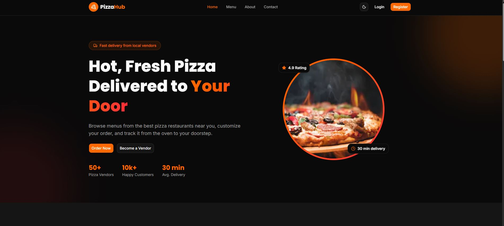

<div align="center">

# 🍕 PizzaHub

**Order, manage and deliver pizza from local shops, all in one place**

A role-based pizza ordering and delivery platform where customers discover local pizza shops and track orders, vendors manage menus and Premium subscriptions, and admins oversee users, menu approvals and transactions.

<p>
  
  
  
  
  
  
</p>

[Live Site](https://pizzahub-client-beige.vercel.app) · [Client Repository](https://github.com/AkramMdkhan/pizzahub-client) · [Server Repository](https://github.com/AkramMdkhan/pizzahub-server)

<br/>



</div>

---

## 📖 About the Project

Ordering food from local shops usually means juggling different menus, unclear order statuses and no easy way for restaurants to manage their listings. Customers do not know which shops are nearby, and vendors struggle to reach customers and keep track of incoming orders.

PizzaHub solves this by putting everything in one place. Anyone can browse the menu, search by item name, filter by category or city and sort by price, then read the full details before ordering. Vendors publish and manage their own menus, and admins keep the platform trustworthy.

**For customers:**
- Discover pizzas, sides and desserts from local shops, with search, category and location filters and price sorting.
- Place an order with delivery details and track it from `pending` to `accepted`, `rejected` or `cancelled`.
- Cancel pending orders and manage your profile from a personal dashboard.

**For vendors (restaurants):**
- Add menu items with images, category, description, price and location.
- Accept or reject incoming customer orders and manage your own menu from one dashboard.
- Start on the Free plan (3 active items) and upgrade to Premium for unlimited items, a vendor badge and featured placement.

**For admins:**
- Manage users, with the ability to block or unblock accounts.
- Approve or reject menu items before they go live.
- Audit all subscription transactions in a read-only view.

**For everyone:**
- Public pages (home, menu and item details) need no login.
- Ordering, menu management and dashboards require a secure account, using email and password or Google.

> **Note on order checkout:** Customers submit food orders directly with their delivery details, with no Stripe checkout on food orders. Stripe Checkout and webhooks are used only for vendor Premium subscription upgrades.

The goal is to make ordering pizza easier for customers, and running a pizza business easier for vendors.

---

## ✨ Features

- **Authentication:** Register and log in with email and password, or continue with Google. Passwords must contain an uppercase letter, a lowercase letter and at least 6 characters. Users choose Customer or Vendor at registration, and Admin accounts are provisioned securely.
- **Landing Page:** Hero banner, featured menu items (approved and active only), 6 pizza categories, a "Why Choose PizzaHub?" section and smooth Framer Motion transitions.
- **Browse Menu:** Public catalog at `/menu` with debounced search, category and location filters, price sorting (ascending and descending), loading skeletons and empty states.
- **Item Details and Order:** Multi-image gallery, vendor details and an Order Now form for logged-in customers. Vendors cannot order their own items, and admins cannot place customer orders.
- **Customer Dashboard:** Overview metrics and charts, a My Orders page with live status and cancellation of pending orders, and profile settings.
- **Vendor Dashboard:** Overview metrics and charts, Add Menu Item with ImgBB image upload, My Menu Items (edit, toggle availability, delete), customer orders with one-time Accept or Reject, and profile settings.
- **Subscriptions:** Compare Free and Premium plans and pay through Stripe Checkout, returning to `/payment/success` or `/payment/cancel`. Premium is activated by verified Stripe webhooks on the server.
- **Admin Dashboard:** Platform KPIs and charts, user management with search, role filter and Block or Unblock, menu item moderation, and a read-only transactions view.
- **Protected Routes and APIs:** Role-based route guards stop users from opening another role's dashboard, and server APIs are secured with JWT. Reloading a private page keeps the user signed in.
- **Responsive Design:** Fully responsive on mobile, tablet and desktop, with a warm pizza theme, toast notifications, custom 404 page and error boundaries.

---

## 🧰 Tech Stack

| Category | Technologies |
| --- | --- |
| Framework | Next.js (App Router), React, TypeScript |
| Styling and UI | Tailwind CSS, shadcn/ui, Lucide Icons |
| Animations | Framer Motion |
| Authentication | Better Auth, JWT, Google OAuth |
| Payments | Stripe Checkout (vendor Premium subscriptions) |
| Notifications | Sonner |
| Media Hosting | ImgBB API |
| Database | MongoDB |
| Deployment | Vercel (client) |

---

## 📦 Dependencies

| Package | Purpose |
| --- | --- |
| `next`, `react`, `react-dom` | Core framework |
| `better-auth` | Authentication |
| `mongodb` | Database driver for Better Auth |
| `tailwindcss` | Styling |
| `lucide-react` | Icons |
| `framer-motion` | Animations and transitions |
| `sonner` | Toast notifications |

See [`package.json`](./package.json) for the complete list.

---

## 🚀 Getting Started

### Prerequisites

- [Node.js](https://nodejs.org/) 20.19 or later
- A MongoDB connection string
- Google OAuth credentials
- A Stripe account (test keys) and an ImgBB API key
- The [PizzaHub server](https://github.com/AkramMdkhan/pizzahub-server) running locally or deployed

### Installation

```bash
git clone https://github.com/AkramMdkhan/pizzahub-client.git
cd pizzahub-client
npm install
```

### Environment Variables

Create a `.env.local` file in the project root. Never commit it to GitHub.

```env
NEXT_PUBLIC_API_URL=http://localhost:5000/api
BETTER_AUTH_SECRET=your_better_auth_secret_key
BETTER_AUTH_URL=http://localhost:3000
NEXT_PUBLIC_BETTER_AUTH_URL=http://localhost:3000
MONGODB_URI=your_mongodb_connection_string
GOOGLE_CLIENT_ID=your_google_client_id
GOOGLE_CLIENT_SECRET=your_google_client_secret
NEXT_PUBLIC_STRIPE_PUBLISHABLE_KEY=pk_test_your_stripe_publishable_key
NEXT_PUBLIC_IMGBB_API_KEY=your_imgbb_api_key
```

The Stripe secret key and webhook secret stay on the server only.

### Run Locally

```bash
npm run dev
```

The app will be available at http://localhost:3000.

### Production Build

```bash
npm run build
npm start
```

---

## 🔗 Links

- **Live Site:** https://pizzahub-client-beige.vercel.app
- **Client Repository:** https://github.com/AkramMdkhan/pizzahub-client
- **Server Repository:** https://github.com/AkramMdkhan/pizzahub-server

---

## 👤 Author

**Akram Mohammad Khan**, MERN Stack Developer

[Portfolio](https://akram-mohammad-khan-portfolio.vercel.app) · [GitHub](https://github.com/AkramMdkhan) · [LinkedIn](https://www.linkedin.com/in/akrammdkhan)
